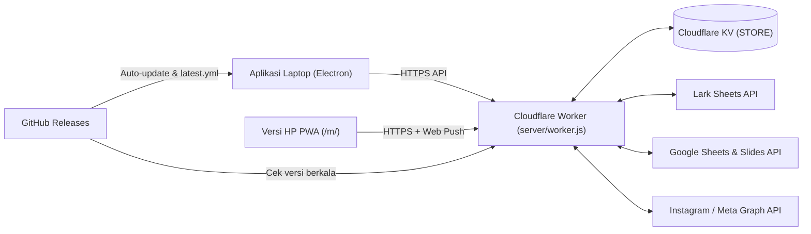

<p align="center">
  
</p>

<h1 align="center">Creative AAB</h1>

<p align="center">
  Aplikasi kerja internal tim creative <strong>Agensi Anak Bangsa (AAB)</strong>: KPI, request creative, editorial plan, kalender konten, insight Instagram, timeline tim, dan notifikasi HP dalam satu ekosistem ringan.
</p>

<p align="center">
  <a href="https://github.com/creative273/creative-aab/releases/latest">
    
  </a>
  <a href="https://github.com/creative273/creative-aab/actions/workflows/release.yml">
    
  </a>
  <a href="https://github.com/creative273/creative-aab/actions/workflows/deploy-worker.yml">
    
  </a>
  
  
</p>

---

## Gambaran Umum

Creative AAB dibangun agar seluruh alur kerja harian tim creative terhubung langsung ke sumber data utama (**Lark Sheets**, **Google Sheets**, **Google Slides**, dan **Instagram Graph API**) sambil tetap berjalan 100% di paket gratis **Cloudflare Workers + KV** dan **GitHub Releases**.

Aplikasi tersedia dalam tiga bagian di satu repositori:

| Bagian | Folder | Teknologi | Fungsi |
|---|---|---|---|
| **Aplikasi Laptop** | [`widget/`](widget/) | Electron (Windows) | Widget ringkas di desktop dan mode jendela penuh untuk kerja harian, personalisasi tampilan, dan auto-update. |
| **Server Pusat** | [`server/`](server/) | Cloudflare Worker + KV | API autentikasi per akun, sinkron berkala Lark, Google, dan Instagram, notifikasi Web Push, serta menyajikan versi HP. |
| **Versi HP (PWA)** | [`mobile/`](mobile/) | HTML/CSS/JS + Service Worker | Aplikasi ringan di Android dan iPhone (`/m/`) khusus notifikasi push dan approval cepat. |

---

## Fitur Utama

### Harian dan KPI
- **Ringkasan**: kartu capaian dengan tren 14 hari, pembanding bulan lalu (MoM), daftar tugas yang perlu segera ditangani, grafik input 7 hari, content plan minggu ini, ringkasan EP, dan aktivitas tim.
- **Input KPI per Divisi**: jalur input terpisah sesuai peran (Content/IG, Design, Video, AIGC), termasuk tarik postingan Instagram otomatis, import Excel, dan tangkapan layar otomatis.
- **KPI Tim Saat Ini (Hanya Baca)**: tampilan kartu KPI modern per peran dan anggota (lengkap dengan bobot, progress bar, selisih target, dan mode tabel asli) yang ditarik berkala dari Lark Sheets.
- **Request Creative**: alur persetujuan Lead (Approve, Pending, Reject) hingga pengerjaan dan pelaporan link output oleh tim.
- **Timeline dan Profil Tim**: kabar harian dengan foto, `@mention`, komentar, reaksi, profil anggota, dan ringkasan aktivitas otomatis.

### Konten dan Media Sosial
- **Editorial Plan (Google Slides)**: daftar konten per akun, pratinjau slide utuh, approval OKE atau Revisi dengan catatan, serta stempel `POSTED` otomatis ke slide dan kalender.
- **Kalender Konten (Google Sheets)**: tambah dan ubah jadwal konten serta centang status Take, Editing, dan Posting langsung ke sheet.
- **Insight Instagram**: pantau followers, views, reach, interaksi, konten terbaik, dan pembaruan angka performa konten ke sheet secara berkala.

### Khusus Lead
- **Kesehatan Sistem dan Kuota**: pemantauan status token Meta/Instagram, estimasi kuota tulis KV harian (`/1.000`) dan panggilan Lark bulanan (`/10.000`) beserta proyeksi akhir bulan, waktu sinkron terakhir, dan log error tiap layanan.
- **Setup Bulan Baru (1 Halaman)**: tempel link Lark bulanan, Content Calendar, dan EP sekaligus, jalankan tes koneksi dan validasi tab, simpan snapshot bulan lalu untuk pembanding MoM, lalu terapkan.
- **Catatan Lead Privat**: catatan perkembangan anggota (Performance, Development, Potential, Arahan) yang tidak terlihat tim dan tidak masuk Timeline, dilengkapi tombol salin ringkasan untuk Monthly Report.

### Versi HP dan Update Otomatis
- **Versi HP (`/m/`)**: pasang lewat Chrome (Android) atau Safari Add to Home Screen (iPhone iOS 16.4+) untuk menerima notifikasi push dan melakukan approval request maupun EP.
- **Notifikasi Update Otomatis**: setiap ada rilis baru, aplikasi laptop otomatis menampilkan banner dan pop-up dengan tombol **Update Sekarang**.

---

## Arsitektur Singkat



---

## Cara Pasang untuk Tim

1. Unduh installer Windows terbaru dari halaman [**Releases**](https://github.com/creative273/creative-aab/releases/latest) (`Creative-AAB-Setup-x.y.z.exe`).
2. Jalankan installer (jika Windows SmartScreen muncul saat pertama pasang, pilih **More info -> Run anyway**).
3. Login dengan username dan password akun masing-masing.
4. Untuk pembaruan berikutnya, cukup klik **Update Sekarang** saat notifikasi muncul.

Panduan setup lengkap (Lark Developer, Google Service Account, Meta/Instagram, Cloudflare, dan pemasangan di HP) tersedia di [**PANDUAN.md**](PANDUAN.md).

---

## Pengembangan dan Pengujian Lokal

Prasyarat: **Node.js 22+**.

```bash
# 1. Jalankan seluruh tes server (menggunakan mock Lark, Google, IG, dan GitHub)
cd server
node --check worker.js
node test/mock-test.mjs
node test/google-test.mjs

# 2. Jalankan server tiruan lokal untuk uji UI (port 8787)
WITH_GOOGLE=1 WITH_IG=1 WITH_FEED=1 WITH_MOBILE=1 WITH_V17=1 node test/dev-server.mjs
```

Jika mengubah file di folder `mobile/`, salin ulang bundelnya ke `server/worker.js` sebelum tes dan commit:

```bash
node server/build-mobile.mjs
```

Untuk memeriksa sintaks aplikasi laptop:

```bash
node --check widget/main.js widget/renderer/app.js widget/renderer/popup.js
```

---

## Alur Rilis dan Auto-Deploy (GitHub Actions)

Repositori ini memakai dua workflow otomatis yang aktif saat perubahan masuk ke branch `main`:

| Workflow | File | Pemicu di `main` | Hasil |
|---|---|---|---|
| **Rilis widget** | [`.github/workflows/release.yml`](.github/workflows/release.yml) | Perubahan di `widget/**` | Membangun installer Windows (`.exe`, `.blockmap`, `latest.yml`) dan menerbitkan GitHub Release sesuai versi di `widget/package.json`. |
| **Deploy Worker** | [`.github/workflows/deploy-worker.yml`](.github/workflows/deploy-worker.yml) | Perubahan di `server/**` atau `mobile/**` | Menyinkronkan versi HP, menjalankan tes server, lalu deploy otomatis ke Cloudflare Worker lewat `wrangler`. |

### GitHub Actions Secrets untuk Auto-Deploy Worker
Diatur di **Settings -> Secrets and variables -> Actions**:
- `CLOUDFLARE_API_TOKEN` (API Token Cloudflare dengan izin Edit Cloudflare Workers)
- `CLOUDFLARE_ACCOUNT_ID` (Account ID Cloudflare)
- `CLOUDFLARE_KV_ID` (ID namespace KV `STORE`)

Variabel dan secret runtime Worker (`LARK_APP_ID`, `LARK_APP_SECRET`, `ADMIN_PASSWORD`, `GOOGLE_SA`) tetap dikelola di dashboard Cloudflare dan tidak ikut terhapus saat deploy (`keep_vars = true` di [`server/wrangler.toml`](server/wrangler.toml)).

---

## Keamanan

- Repositori ini bersifat publik: **tidak ada** token, password, kunci service account, atau ID rahasia yang disimpan di dalam kode.
- Seluruh rahasia runtime disimpan hanya di Cloudflare Workers Secrets dan KV terenkripsi, serta tidak pernah dikirim ke aplikasi laptop tim.
- Renderer Electron menerapkan Content Security Policy (CSP) ketat.

---

## Dokumentasi Terkait

- [**PANDUAN.md**](PANDUAN.md): panduan setup awal, penggunaan harian tiap peran, versi HP, dan pemecahan masalah.
- [**HANDOFF.md**](HANDOFF.md): peta kode, daftar key KV, prosedur rollback, dan catatan teknis untuk pengembang atau asisten AI.
